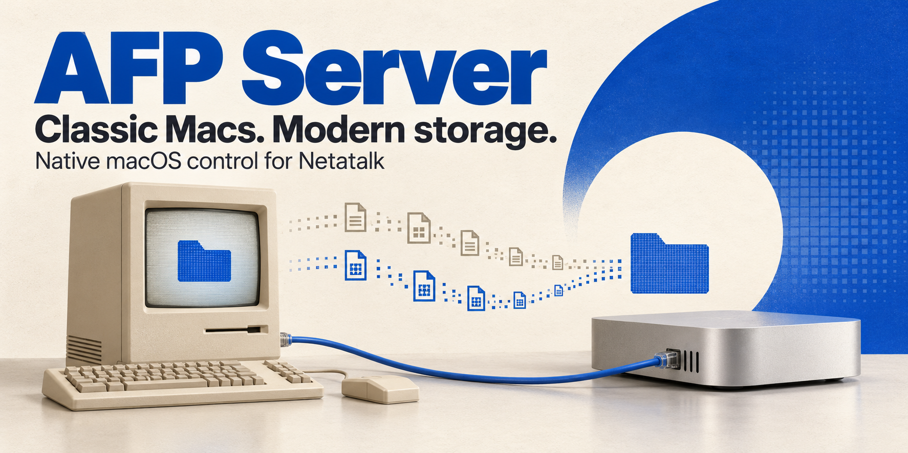

<p align="center">
  
</p>

# AFP Server

## Classic Macs. Modern storage.

**A native macOS control panel for Netatalk — from the first install to the last resource fork.**

Keep a vintage Mac connected to your present-day setup. AFP Server brings server controls, shares, connections, sharing accounts, Netatalk updates and Classic Mac metadata care into one AppKit application.

[**Download for macOS**](https://github.com/powermac84/afp-server/releases/latest) · [What happens under the hood](#what-actually-happens) · [Validation](#tested-and-unverified)

Netatalk does the AFP file serving. This app manages it. Clients connect over **AFP/TCP/IP**; the app does not add an AppleTalk networking stack to modern macOS. This is an independent project, not an official Netatalk or Apple product.

## Get started

1. Download `AFP-Server-1.4.1-macOS.zip` from [Releases](https://github.com/powermac84/afp-server/releases/latest), extract it and open **AFP Server.app**.
2. If Netatalk is missing, open **Updates**, choose **Check now**, then **Install Netatalk**. The package workflow requires an existing [Homebrew](https://brew.sh/) installation.
3. Select the real `afp.conf` in **Settings**, review its shares, then choose **Start** in **Overview**. Privileged server administration uses the normal macOS administrator prompt.
4. On your Classic Mac, connect to the server's reachable IPv4 address using AppleShare over TCP/IP and your configured sharing account.

The downloadable app is a **universal macOS development build (Apple Silicon + Intel), locally ad-hoc signed and not Developer ID notarized**. It was tested on macOS 27.2. Opening on a different Mac has not been verified. The project targets macOS 13+, but that deployment target is not a claim of testing every macOS release. Use macOS's individual-app approval flow if required by your system.

## One window for the whole setup

| Page | What it gives you |
| --- | --- |
| **Overview** | Start, stop and restart; detected interfaces, IPv4 addresses and listening sockets; useful failures instead of a successful command being mistaken for a running server. |
| **Shares** | Native folder selection and editing of the selected configuration, with a preview, backup and validation before writing. |
| **Connections** | Local and remote TCP endpoints; authenticated AFP sessions when `afpstats` is available and permitted. Process UIDs are shown separately from AFP usernames. |
| **Accounts** | Existing local accounts, app-managed hidden sharing accounts, password changes for those managed accounts, and folder access rules. |
| **Classic Metadata** | Inventory, conservative AppleDouble restoration, a real Type/Creator/resource-fork test file, verified import, and offline CNID maintenance. |
| **Settings** | AFP settings and separate controls for app login, server boot startup and optional metadata care. |
| **Activity & Diagnostics** | Action results, errors, local diagnostic output and access to logs and backups. |
| **Updates** | Installed and latest stable Netatalk versions, manual checks, installation/update buttons and an optional daily check. |

## What actually happens

### Opening the app

The app reads its preferences, discovers Netatalk and its configuration, and refreshes local status. Opening it does not start the daemon or enable startup services. Closing its window leaves the menu-bar app running; quitting the app leaves an independently running Netatalk server alone.

Administrator snapshots are timestamped snapshots, not a continuous privileged feed. Incomplete or unavailable session information is labelled accordingly. There are no invented transfer-speed figures.

### Installing or updating Netatalk

The app queries the official Netatalk GitHub repository for its latest **published stable release**. After you click Install or Update, it:

1. Requires Netatalk and its CNID daemons to be stopped. It does not disconnect clients for a package update.
2. Saves and verifies private backups of existing configuration files.
3. Refreshes Homebrew metadata and checks that Homebrew's stable version, source URL and source SHA-256 match the official upstream release.
4. Runs Homebrew's Netatalk install or upgrade command as the logged-in user. Homebrew manages the package and its dependencies.
5. Verifies the installed version and preserved configurations. A newly generated default configuration can inherit the previously selected settings; a pre-existing default is preserved.
6. Reports the result and leaves the server stopped for your review.

A Homebrew formula that has not caught up with upstream produces an explanation, not an older package presented as the latest version. Known installations outside Homebrew are not automatically replaced.

If AFP authentication setup is missing, **Finish AFP setup** offers the normal administrator approval flow for the supported OpenDirectory PAM policy. Existing custom policies are preserved. Package installation and updates do not run Homebrew as root.

### Regular checks, deliberate updates

**Check daily while AFP Server is open** is enabled by default and can be switched off. It checks roughly every 24 hours while the application is running. You can also use **Check now**.

The check contacts GitHub's public release endpoint and stores the result locally. It does not install anything. There is no update-check service running after you quit the app. Installation always needs your click, and the current version gets an “up to date” state rather than an unnecessary reinstall.

### Changing shares or server settings

You review the new configuration before it is written. The app backs up the existing file, validates paths and settings, writes atomically and rejects a stale edit if another process changed the configuration in the meantime.

Applying a change to a running server can restart it and interrupt clients; the confirmation explains this. Restart verification failures trigger rollback handling, and rollback failures are reported explicitly. A stopped server stays stopped.

### Keeping Classic Mac files intact

Classic Mac files can carry a data fork, a resource fork and Finder metadata such as Type and Creator codes. Copying the visible file alone can lose part of the file's meaning.

Metadata restoration is scoped to the selected share. It backs up and retains the AppleDouble source, adds only missing native attributes and skips conflicting metadata. It pauses when clients are connected or their status cannot be established. It cannot reconstruct resource-fork contents that no longer exist.

Import requires **Netatalk's `nad` 4.6 or newer**. The app confirms the destination is a recognised AFP volume, copies into a private staging folder, preserves missing native FinderInfo/resource-fork attributes, and verifies the source and copied contents before publishing through `nad mv -n`. Existing destinations are protected. Symlinks and nested mounted volumes in the source are rejected; failed imports retain staging data for inspection.

CNID maintenance is an explicit offline operation. It confirms the daemon is stopped, requires a recognised database backup for repair, avoids a forced database wipe, and attempts to restore the previous running state afterward.

### Accounts and startup

New app-managed sharing accounts are local, hidden and non-administrator, with no interactive login shell. Passwords go to the helper through an in-memory pipe, never command arguments or app logs. Password resets and account deletion are limited to accounts the app manages. Share allowlists and filesystem permissions remain separate controls.

App login, Netatalk server boot and metadata care are separate choices. Enabling the app's optional login or metadata services requires a stable location in `/Applications` or your user Applications folder. App removal preserves Netatalk, accounts, configuration, shared files and retained logs/backups.

## Tested and unverified

The 1.4.0 functional baseline was verified locally on **Apple Silicon, macOS 27.2, Xcode 27.2 and the macOS 27.2 SDK** on 30 October 2026:

- **24 XCTest methods passed**, both normally and with AddressSanitizer/UndefinedBehaviorSanitizer.
- All eight UI pages were launched, rendered and visually reviewed; the embedded helper passed its self-test.
- Homebrew's real AFP test server returned the expected protocol response on a temporary port, then exited.
- A real `nad` 4.6.1 import into an isolated SQLite-backed share retained Type `TEXT`, Creator `ttxt`, its data fork and exact resource-fork bytes, verified again through MacBinary export.
- App and helper passed strict code-signature verification, including after ZIP extraction.

The public 1.4.1 source uses generic examples. On 2 November 2026, its 24 XCTest methods passed again, normally and with AddressSanitizer/UndefinedBehaviorSanitizer, and the universal Release build completed. See [VALIDATION.md](VALIDATION.md) for the separate baseline and public-release test records.

There has been no Classic Mac client/password test, Intel runtime test or older-macOS compatibility sweep. A real future-version upgrade was unavailable during validation; the update logic was checked with live release metadata, the already-current path, version/checksum tests and disposable configuration fixtures. Privileged real-account changes, boot registration and live-share repairs were not exercised against a user's existing data. External `nad` pathname arguments retain a limit against deliberately hostile, simultaneous path manipulation by a process with the same user rights.

## Build from source

Open `AFP Server.xcodeproj` in Xcode and select **AFP Server → My Mac**. The project builds the application and its separate embedded helper using Apple's SDK and local signing.

The shared schemes are **AFP Server** and **AFP Server - Sanitizers**. To run the regular suite from the repository root:

```sh
xcodebuild -project "AFP Server.xcodeproj" \
  -scheme "AFP Server" -destination 'platform=macOS' test
```

The source build does not install Netatalk, start the server or register background services.

## Credits

Built by Patrick Alan Banfield. AFP serving and its command-line tools are provided by [Netatalk](https://netatalk.io/); package installation uses [Homebrew](https://brew.sh/). Apple and Macintosh names belong to their respective owners.
